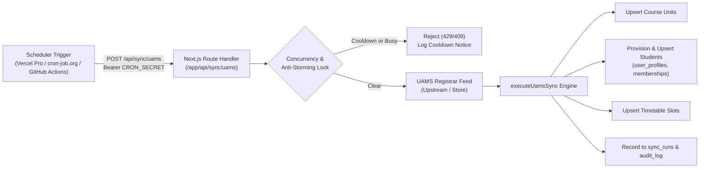

# UAMS Automated Sync Scheduler & Anti-Storming Architecture (Tiny B)

**Target Application:** Student Life & Campus Hub (`student-life-campus-hub`)  
**Sync Cadence:** Every 15 minutes (`*/15 * * * *`)  
**Guarded Endpoint:** `POST /api/sync/uams`  
**Authentication:** `Authorization: Bearer <CRON_SECRET>`  

---

## 1. Executive Summary & Architecture

The University Academic Management System (UAMS) acts as the system of record for student enrollments, course units, and timetable allocations. To ensure registrar updates seamlessly reach student devices without manual administrator intervention, the platform provides automated synchronization on a **15-minute interval**.



---

## 2. Hosting Plan Trade-Offs & Recommended Schedulers

| Environment / Host | Cron Capability | Fit & Strategy |
| :--- | :--- | :--- |
| **Vercel Pro** | Sub-daily crons supported (`*/15 * * * *`) | **Native**: Uses repository `vercel.json`. Vercel automatically passes `CRON_SECRET` in the `Authorization` header. |
| **Vercel Hobby** | **Strictly limited to 1 execution per day** (`0 0 * * *`) | **External Scheduler Required**: Attempting to deploy `*/15 * * * *` on Vercel Hobby results in deployment failure (`A Hobby account is limited to 1 cron job...`). Use **cron-job.org** or **GitHub Actions**. |
| **External: cron-job.org** | Free sub-hourly cron triggers | **Recommended for Hobby**: Free tier allows 15-minute triggers. Configure HTTP POST to `https://<domain>/api/sync/uams` with header `Authorization: Bearer <CRON_SECRET>`. |
| **External: GitHub Actions** | Free scheduled cron (`schedule: '*/15 * * * *'`) | **Zero-Cost Automation**: Provided out-of-the-box via `.github/workflows/uams-sync.yml`. Binds repository secret `CRON_SECRET`. |
| **Container / Self-Hosted** | Node.js process / Systemd / Crontab | **Embedded Daemon**: Run `npm run tsx scripts/uams-scheduler.ts` as a long-running background sidecar. |

### Decision Guide:
* **Production on Vercel Pro:** Commit `vercel.json` and set `CRON_SECRET` in Vercel Environment Variables.
* **Staging / Pilot on Vercel Hobby:** Keep `vercel.json` for pro parity, and enable the GitHub Action workflow (`.github/workflows/uams-sync.yml`) or configure a **cron-job.org** monitor.

---

## 3. External Scheduler Configuration Guide (cron-job.org)

If using **cron-job.org**:
1. **Title**: `Campus Hub UAMS Auto-Sync`
2. **URL**: `https://<your-campus-hub-domain>/api/sync/uams`
3. **Execution Schedule**: `User-defined` &rarr; `Every 15 minutes` (`0, 15, 30, 45 * * * *`)
4. **HTTP Method**: `POST`
5. **Request Headers**:
   ```http
   Authorization: Bearer <YOUR_CRON_SECRET>
   Content-Type: application/json
   ```
6. **Request Body** (optional):
   ```json
   {
     "version": 1,
     "dry_run": false
   }
   ```
7. **Failure Notifications**: Check `Send email on failure`.
8. **Disable Auto-Retry**: Ensure aggressive automatic retries are disabled to uphold anti-storming guarantees.

---

## 4. Anti-Storming & Failure Protection Rules

Automated sync jobs must never overwhelm or denial-of-service the upstream UAMS infrastructure during university peak registration periods or network degradation. The system implements four layers of defense:

1. **Concurrency Mutex Lock**:
   - `isSyncInProgress` flag guards `executeUamsSync`.
   - If an automated run is already executing when a new trigger arrives, the second run is immediately rejected (`409 Conflict`), preventing thread exhaustion and database lock contention.
2. **Failure Cooldown Backoff**:
   - When a sync run encounters errors or network faults, a **60-second cooldown period** is automatically enforced.
   - Any scheduled pings arriving during the cooldown are dropped with a warning, preventing rapid retry-storms against an already struggling upstream service.
3. **Upstream Request Timeout**:
   - Upstream fetch calls use an `AbortController` with an **8-second timeout**, preventing hung sockets and lingering database connections.
4. **Loud Failure Logging**:
   - Failures write a record with `status: "failed"` and detailed error strings to `public.sync_runs`.
   - Failures log an activity row to `public.audit_log` with action `"uams_sync_failed"`.
   - System outputs a structured `console.error` with error diagnostics.
   - Admin UI reflects the failure prominently in the sync monitoring card.
